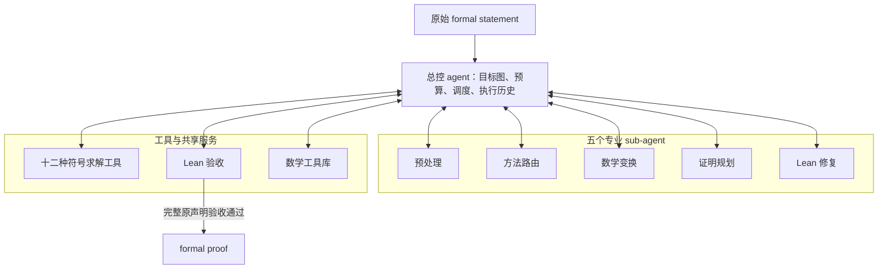

# 有限 q 恒等式证明系统的 Agent 架构建议

日期：2026-10-26  
依据：项目现有实现、用户提供的「第三版」框架图及后续讨论。  
状态：用户已明确预处理、方法路由、数学变换、证明规划、修复这五类为 sub-agent；下文具体职责、接口和调度方式为设计建议，不表示新增能力已经实现。

采用 **“一个总控 agent＋五个专业 sub-agent＋符号求解、Lean 验收、数学工具库”** 的结构。

五个 sub-agent 分别是：**预处理、方法路由、数学变换、证明规划、Lean 修复**。它们具有各自的任务上下文，能够在职责和预算内选择工具、分析反馈、调整动作，并向总控返回结构化结果。它们可以共享同一种模型，按需启动，不要求五个模型或五个进程始终同时运行。

现有预处理器、选择器和十二种符号方法仍作为可调用程序保留。独立程序或进程本身不等于大模型 sub-agent；sub-agent 的作用在于组织这些工具的使用并根据结果作出决策。

**总控 agent 负责全局调度。** 它保存原目标、证明依赖图、候选队列、预算和执行历史，派发任务、接收证据、处理失败与停止条件。专业 sub-agent 提出建议或交付局部结果，总控决定实际派发顺序和资源分配。

| Sub-agent | 职责与决策范围 | 主要工具 | 应交付什么 |
|---|---|---|---|
| **预处理 sub-agent** | 理解原声明的类型、假设和数学对象；选择公共表示、受控展开及整理方式；根据工具反馈调整 | 现有预处理器、表达式导出器、数学工具库、转换证据检查 | 标准表示、原式到标准表示的认证转换、保留的未知结构和未解决问题 |
| **方法路由 sub-agent** | 根据目标结构、方法能力和已有失败信息，提出并更新候选方法顺序；说明适用性与未决条件 | 现有选择器、方法能力契约、结构化尝试记录 | 候选队列、选择理由、适用性未决项和资源分配建议 |
| **数学变换 sub-agent** | 针对具体结构阻塞，搜索重编号、拆分、参数代换及表示转换，形成更适合求解的新目标 | 数学工具库、认证变换工具、必要的符号计算和 Lean 检查 | 新目标、转换条件、接回父目标的证明或尚待证明的桥接义务 |
| **证明规划 sub-agent** | 设计归纳、分类讨论、辅助引理和多方法组合；组织子目标之间的依赖 | 数学工具库、方法能力信息、证明骨架检查 | 子目标图、各子目标的上下文、由子目标推出父目标的证明骨架 |
| **Lean 修复 sub-agent** | 根据 Lean 反馈定位和修复候选证明中的名称、类型、重写、组装等问题；识别并报告实际数学缺口 | Lean 编译与诊断、引理检索、候选证明文件编辑 | 修订后的候选证明、修改记录，或交回总控的未闭合数学义务 |

**符号求解不单独设置为 sub-agent，作为确定性工具层。** 十二种方法继续各自负责“表示转换→证书构造→原域义务→原题出口”，保留方法内部已有的候选搜索和 Lean 生成器。总控根据路由建议调用方法；规划器提出的子目标也由总控安排执行。

| 工具或服务 | 职责 | 与 sub-agent 的关系 |
|---|---|---|
| **十二种符号求解工具** | 在各自声明的范围内构造证书，生成证明或报告剩余义务 | 方法路由推荐，总控派发；结果可用于规划、变换和修复 |
| **Lean 验收服务** | 按固定规则检查精确目标、原假设、公理、证明文件和依赖 | 各 sub-agent 可请求局部检查；整题成功必须通过完整原声明验收 |
| **共享数学工具库** | 提供带类型和适用条件的对象定义、规则及已验证引理 | 五个 sub-agent 和符号工具均可按需查询 |

初始候选证明可由符号方法自带的生成器或规划阶段的证明骨架产生；修复 sub-agent 负责后续反馈修复。生成候选、完成局部证明和通过完整原题验收分别记录。

简化后的组织关系如下。为避免连线过多，图中只画出总控与各组件的主要关系；专业 sub-agent 也可在各自权限内使用工具和服务。

**预处理与数学变换的区别是“是否针对求解策略”。** 预处理执行方法无关的公共整理；数学变换则根据具体失败原因寻找更适合某个方法的表达。例如，预处理保留 Pochhammer 结构，数学变换为接入某种证书算法而选择特定展开。现有[预处理契约](../preprocessing/README.md)可作为公共整理的基础。

**方法路由负责“用哪个方法”，证明规划负责“需要证明什么”。** 路由面对同一个目标排列候选；规划可以把目标拆为初值、递推关系、边界项等多个义务。规划器可以在发现结构缺口时介入，不必等十二个方法全部耗尽预算。总控负责实际派发和全局预算，避免路由与总控重复决策。

**Lean 修复与最终验收分开。** 修复 sub-agent 可以修改候选证明并请求检查，但不能自行宣布正确。验收服务固定检查原声明、假设、公理和依赖，现有 [accept_proof](../workflow/contracts.py) 可作为基础。若缺少分母非零证明、边界条件或奇异点处理，修复角色应报告数学义务，交由总控安排规划或变换，不能通过加强原题假设来消除错误。

所有阶段都可能失败，不能只在 Lean 检验错误之后进入诊断。失败分类先由程序记录；复杂原因可交给相应 sub-agent 分析，不额外设置第六个诊断 sub-agent。

| 实际阻塞 | 总控应安排的动作 |
|---|---|
| 原式无法进入方法表示 | 由预处理检查对象解释，必要时安排数学变换 |
| 方法明确不支持当前结构 | 由方法路由调整候选，或安排数学变换 |
| 搜索没有找到证书 | 根据失败证据调整合法搜索配置，或由路由推荐其他方法 |
| 已有证书，但边界、初值、分母条件未闭合 | 由证明规划建立剩余数学子目标 |
| 数学步骤齐全，Lean 名称、类型或重写失败 | 交给 Lean 修复 |
| 预算耗尽 | 保留进展并返回未完成 |

**Sub-agent 之间通过总控传递带上下文和证据的任务，聊天内容只作辅助。** 每个任务至少包含：

- 精确目标、变量、类型、假设，以及所属父目标。
- 使用的表达式版本、数学库版本和已证明引理。
- 任务范围、允许工具、所需证书或转换方向。
- 尚未闭合的条件、已尝试路线、失败阶段和剩余预算。
- 返回的证明文件、证书、依赖和验收状态。

例如，规划器把原目标 $G$ 拆为 $L_1,L_2$，不仅要写出两条引理，还要提供可检查的组装关系：

$$
(L_1\land L_2)\;\Longrightarrow\;G.
$$

子引理必须保留准确的上下文；额外条件必须另行证明或通过完整分类讨论消除。证明依赖形成无循环的图；执行过程可以反馈迭代，但不能让父目标与子目标互相作为已证明前提。相同目标和相同配置的重复尝试需要去重，所有子任务共同受原题总预算约束。

**现有入口主要按 Train 题号加载原声明，任意新生成子引理的统一入口仍需补充。** 应增加“目标任务”接口，让原题和子引理都能进入方法，同时保留与原声明的来源关系。仅将现有脚本包装为 sub-agent 尚不足以实现递归分解求解。

十二方法继续遵守[方法独立性原则](METHOD_IMPROVEMENT_PRINCIPLES.txt)：共享基础引理，跨方法求解显式登记为组合证明，不把组合路线回填为单方法独立成绩。

**数学工具库保持共享服务的定位。** 现有 [math_library](../math_library/README.txt) 已经包含对象、条件、机器规则和 Lean 依据。完整证明可以归档；抽取出的可复用引理还需保留全部假设、独立验证、登记依赖和版本。正式评测期间固定库版本，新增内容在下一版本启用；入库流程不自动增加一个独立 sub-agent。

建议的落地顺序是：先建立统一目标任务和总控状态机，接好现有预处理、候选队列、十二方法和验收；随后赋予预处理与路由 sub-agent 有边界的策略选择能力，加入数学变换及 Lean 修复；最后接通证明规划中的递归拆引理和跨方法组合。每一步分别检查新增能力、证据完整性与预算消耗。

尚待明确的范围选择：第一版先服务于现有 Train 恒等式，还是从一开始就支持用户输入任意 Lean 声明。
